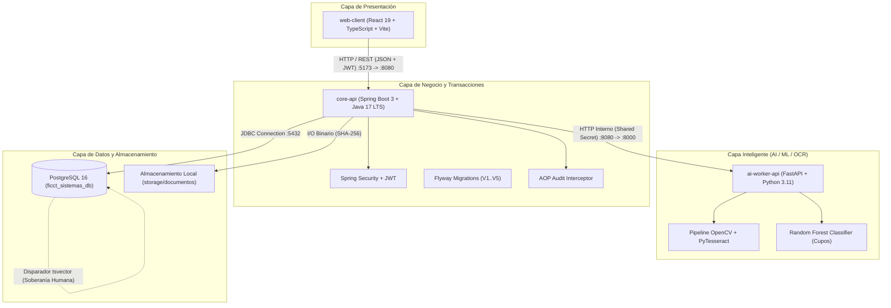

# SistemaFICCT

**Sistema Web de Gestión Administrativa con Alertas Predictivas y OCR para la Dirección de Carrera de Ingeniería en Sistemas**  
*Facultad Integral de Computación, Carreras de Informática y Telecomunicaciones (FICCT) — Universidad Autónoma Gabriel René Moreno (UAGRM)*

---

## 1. Descripción General

**SistemaFICCT** es una plataforma web modular diseñada específicamente para optimizar y modernizar los procesos operativos, académicos y de toma de decisiones en la Dirección de Carrera de Ingeniería en Sistemas de la FICCT–UAGRM.

El sistema resuelve la dispersión de información física, la demora en la emisión de dictámenes estudiantiles, la sobrecarga en mesas de examen y la incertidumbre en la apertura de cupos semestrales. Integra digitalización con visión artificial (OCR), búsqueda documental lingüística, seguimiento formal de trámites bajo máquina de estados finitos y modelos analíticos de aprendizaje supervisado (*Random Forest*) bajo el principio rector de **Soberanía Humana**, garantizando que la inteligencia artificial actúe exclusivamente como herramienta consultiva y de soporte técnico.

---

## 2. Características Principales

El sistema se compone de módulos funcionales totalmente implementados e integrados:

- **Seguridad y Control de Acceso Basado en Roles (RBAC):** Autenticación mediante tokens JWT firmados con HMAC-SHA512, gestión de sesiones sin estado (*stateless*), suspensión/activación de personal y transferencia atómica de la autoridad de Dirección (CU-04).
- **Mesa de Entrada y Correspondencia CITE:** Registro oficial de correspondencia recibida, emitida e interna con generación secuencial de códigos CITE institucionales y vinculación de archivos digitales.
- **Gestión Documental y Repositorio Seguro:** Almacenamiento local estructurado con cálculo automático de firma hash SHA-256 para garantizar la integridad y no repudio de los documentos.
- **Máquina de Estados de Trámites Académicos (RN-05):** Ciclo de vida estricto de expedientes estudiantiles (`INGRESADO` → `EN_VERIFICACION` → `CON_DICTAMEN` → `APROBADO` / `RECHAZADO` → `CONCLUIDO`), con historial inmutable de transiciones y control de soberanía directiva.
- **Visor Dual OCR con PyTesseract:** Procesamiento de imágenes y documentos escaneados mediante preprocesamiento con OpenCV y extracción de texto por PyTesseract en microservicio dedicado.
- **Soberanía Humana y Búsqueda Lingüística:** El texto extraído solo se indexa tras la validación humana en el visor comparativo. Un disparador (*trigger*) en PostgreSQL genera vectores de búsqueda `tsvector` en español, habilitando búsqueda por texto completo con resaltado visual (`<mark>`).
- **Planificación Curricular y Gestión Académica:** Administración de planes de estudio (Malla 187-3), asignaturas, prerrequisitos, apertura de periodos semestrales, grupos paralelos y asignación de carga horaria docente.
- **Predicción de Demanda de Cupos con Machine Learning:** Inferencia supervisada basada en ensamble *Random Forest Classifier* ($K=5$, $F_1 \ge 0.80$), que evalúa la demanda histórica y emite recomendaciones de cupos con alertas semafóricas (Verde, Amarillo, Rojo) acompañadas de avisos consultivos no vinculantes.
- **Dashboard Institucional y Monitoreo de Alertas:** Panel centralizado de KPIs directivos (población estudiantil, avance POA, trámites en curso y titulados), con atención y resolución administrativa obligatoria de alertas institucionales.
- **Compilador de Dossier Institucional (RPA):** Generación automatizada de informes oficiales en formato PDF compilados a partir de los registros del periodo y sellados criptográficamente con SHA-256.
- **Bitácora Inmutable de Auditoría:** Interceptor AOP (`@Auditable`) que registra automáticamente fecha, hora, dirección IP, módulo, acción y usuario sobre operaciones críticas de la base de datos.

---

## 3. Tecnologías Utilizadas

| Componente | Tecnología | Versión | Propósito |
| :--- | :--- | :--- | :--- |
| **Frontend** | React | 19.3.1 | Interfaz de usuario declarativa |
| | TypeScript | 7.0.2 | Tipado estático y robustez en cliente |
| | Vite | 8.3.8 | Herramienta de compilación y servidor dev |
| | Tailwind CSS | 4.3.5 | Sistema de diseño y estilos utilitarios |
| | Axios | 1.21.1 | Cliente HTTP con interceptores JWT |
| **Backend Core** | Java | 17 LTS | Lenguaje base del servidor transaccional |
| | Spring Boot | 3.5.0 | Framework corporativo backend |
| | Spring Security | 6.x | Seguridad perimetral, RBAC y filtros JWT |
| | Spring Data JPA / Hibernate | 6.x | Capa de persistencia y mapeo relacional |
| | Flyway | 10.x | Control de versiones y migraciones de BD |
| **AI Worker API** | Python | 3.11.9 | Motor de visión y analítica predictiva |
| | FastAPI | 0.165.0 | Framework asíncrono para endpoints de IA |
| | Uvicorn | 0.54.0 | Servidor ASGI de alto rendimiento |
| | OpenCV (Headless) | 5.1.0 | Procesamiento y binarización de imágenes |
| | PyTesseract | 0.3.13 | Extracción de texto mediante OCR |
| | Scikit-Learn | 1.9.1 | Modelo predictivo Random Forest |
| **Base de Datos** | PostgreSQL | 16.x | Motor relacional con soporte nativo Full-Text Search |
| **Motor OCR** | Tesseract OCR | 5.4.0 | Reconocimiento óptico de caracteres (soporte `spa`) |

---

## 4. Arquitectura del Sistema

El sistema implementa una arquitectura desacoplada basada en microservicios y clientes web ligeros:



---

## 5. Roles del Sistema y Control de Acceso

El sistema implementa un modelo de Control de Acceso Basado en Roles (**RBAC**) estricto:

### 1. Director de Carrera (`ROLE_DIRECTOR`)
- **Responsabilidad:** Máxima autoridad ejecutiva y de gobierno institucional.
- **Permisos Exclusivos en Backend:**
  - Aprobación o rechazo definitivo de trámites estudiantiles mediante dictamen vinculante.
  - Gestión de personal administrativo (emisión de invitaciones con token UUID y suspensión/reactivación).
  - Consulta y filtrado de la bitácora inmutable de auditoría institucional.
  - Ejecución de la transferencia de autoridad directiva (CU-04).
  - Generación del Dossier Institucional Oficial en PDF sellado con SHA-256.

### 2. Coordinador Académico (`ROLE_COORDINADOR`)
- **Responsabilidad:** Gestión técnico-curricular, monitoreo de demanda y apoyo docente.
- **Permisos Implementados:**
  - Revisión académica de expedientes y emisión de dictamen técnico preliminar (`CON_DICTAMEN`).
  - Consulta y análisis del modelo predictivo de cupos (*Random Forest*) y mallas curriculares.
  - Planificación de grupos, cupos y cobertura docente semestral.
  - Registro de resolución humana para la atención de alertas institucionales.
  - **Restricciones:** No puede aprobar trámites ni acceder a la gestión de personal ni auditoría (protegido con HTTP 403 Forbidden).

### 3. Auxiliar de Dirección (`ROLE_AUXILIAR`)
- **Responsabilidad:** Operación de ventanilla única, mesa de entrada y digitalización.
- **Permisos Implementados:**
  - Recepción de correspondencia física, asignación de código CITE y digitalización de documentos.
  - Ejecución del procesamiento OCR y validación humana del texto extraído.
  - Recepción de trámites estudiantiles (`INGRESADO`), derivación a revisión (`EN_VERIFICACION`) y entrega final al estudiante (`CONCLUIDO`).
  - **Restricciones:** No tiene acceso a planificación curricular, directiva, alertas, usuarios ni auditoría.

---

## 6. Estructura del Repositorio

```text
SistemaFICCT/
├── core-api/                       # Backend transaccional (Spring Boot 3, Java 17)
│   ├── src/main/java/              # Lógica de dominio, servicios, controladores y seguridad
│   ├── src/main/resources/         # Configuración y migraciones SQL Flyway (V1..V5)
│   ├── pom.xml                     # Dependencias Maven
│   └── Dockerfile                  # Empaquetado de producción en contenedor
│
├── ai-worker-api/                  # Microservicio de IA (FastAPI, Python 3.11)
│   ├── app/engines/                # Motores de preprocesamiento, OCR y Random Forest
│   ├── requirements.txt            # Dependencias pip
│   └── Dockerfile                  # Empaquetado contenedor de visión artificial
│
├── web-client/                     # Frontend SPA (React 19, TypeScript, Vite, Tailwind v4)
│   ├── src/pages/                  # Vistas por módulo funcional
│   ├── src/layouts/                # Layout administrativo y navegación adaptativa
│   ├── src/services/               # Cliente Axios y configuración de proxy reverso
│   └── vite.config.ts              # Configuración de compilador y proxy
│
├── docs/                           # Documentación de arquitectura y requisitos
├── Pruebas Manuales/               # Guías, datasets poblados y reservados para QA
├── docker-compose.yml              # Orquestación de servicios en contenedores
├── iniciar_sistema.bat             # Script de arranque integral para Windows
└── detener_sistema.bat             # Script de apagado ordenado de procesos locales
```

---

## 7. Requisitos Previos

Para ejecutar el proyecto en un entorno de desarrollo en **Windows 10 / 11**, se requieren las siguientes herramientas instaladas:

- **Java JDK:** Eclipse Adoptium Temurin 17 LTS (versión 17.0.x).
- **Python:** Python 3.11.x (disponible en el PATH).
- **Node.js:** Versión 20.x o 22.x LTS y gestor de paquetes `npm`.
- **PostgreSQL:** Versión 16.x escuchando en el puerto local predeterminado `5432`.
- **Tesseract OCR:** Versión 5.4.x instalada con el paquete de idioma español (`spa`).

---

## 8. Instalación y Configuración

### Paso 1: Clonar el Repositorio
```cmd
git clone https://github.com/VAYozzi/SistemaFICCT.git
cd SistemaFICCT
```

### Paso 2: Configurar la Base de Datos
En PostgreSQL local, crear una base de datos exclusiva para el proyecto:
```sql
CREATE DATABASE ficct_sistemas_db;
```

### Paso 3: Configurar Variables de Entorno
Copiar el archivo de plantilla a la raíz del proyecto:
```cmd
copy .env.example .env
```
*(Asegurarse de definir los valores de conexión de PostgreSQL y las claves secretas internas).*

### Paso 4: Preparar el Entorno Virtual de Python (AI Worker)
```cmd
cd ai-worker-api
python -m venv venv
.\venv\Scripts\activate
pip install -r requirements.txt
cd ..
```

### Paso 5: Instalar Dependencias del Frontend
```cmd
cd web-client
npm install
cd ..
```

---

## 9. Ejecución del Sistema

El proyecto cuenta con un script de arranque automatizado que verifica el servicio de PostgreSQL, compila e inicializa Spring Boot en el puerto `8080`, levanta FastAPI en el puerto `8000` e inicia Vite en el puerto `5173`:

```cmd
iniciar_sistema.bat
```

Una vez finalizado el inicio, los servicios estarán disponibles en:
- **Frontend (Web):** `http://localhost:5173`
- **Backend Core API (REST):** `http://localhost:8080/api/v1`
- **AI Worker API (Docs):** `http://127.0.0.1:8000/docs`

Para detener todos los servicios de forma limpia:
```cmd
detener_sistema.bat
```

---

## 10. Pruebas y Validación

El repositorio cuenta con recursos para pruebas automáticas y manuales:

- **Pruebas de Regresión Integral:** Script `run_full_regression.ps1` que valida la máquina de estados, el procesamiento de OCR, la predicción de cupos y la generación del dossier institucional.
- **Carpeta de Pruebas Manuales (`Pruebas Manuales/`):**
  - `00_GUIA_GENERAL/Matriz_42_Pruebas.csv`: Catálogo de 42 casos de prueba (positivos y negativos) clasificados por módulo y rol.
  - `01_DATOS_INICIALES_POBLADOS/`: Registro de la información cargada para demostraciones.
  - `02_DATOS_NUEVOS_PARA_PRUEBAS/`: Datasets y documentos PDF/imágenes reservados para ingreso manual desde los formularios.
  - `03_CASOS_NEGATIVOS/`: Casos diseñados para validar bloqueos RBAC (403), transiciones no permitidas (409) y validaciones de formulario (400).

---

## 11. Contexto Académico

Este proyecto ha sido desarrollado en el marco académico de la **Facultad Integral de Computación, Carreras de Informática y Telecomunicaciones (FICCT)** de la **Universidad Autónoma Gabriel René Moreno (UAGRM)**, Santa Cruz de la Sierra, Bolivia, como propuesta integral de ingeniería de software para la gestión universitaria moderna.
