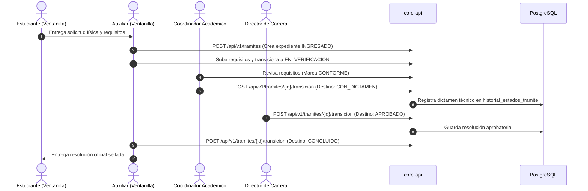
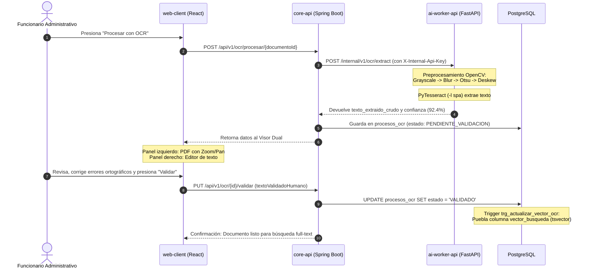

# 06_USE_CASES_AND_WORKFLOWS.md
# Casos de Uso del Sistema y Flujos de Trabajo Operativos (Workflows)

## 1. Mapeo Oficial de Casos de Uso (CU-01 al CU-37)

| Código | Nombre del Caso de Uso | Actor Principal | Módulo Funcional |
| :--- | :--- | :--- | :--- |
| **CU-01** | Gestionar Cuenta y Acceso | Todos los Funcionarios | Seguridad / Auth |
| **CU-02** | Gestionar Roles y Permisos Institucionales | Director de Carrera | Seguridad / Auth |
| **CU-03** | Consultar Bitácora de Auditoría | Director de Carrera | Seguridad / Auditoría |
| **CU-04** | Transferir Autoridad de Dirección | Director de Carrera | Seguridad / Auth |
| **CU-05** | Gestionar Invitaciones Institucionales | Director de Carrera | Seguridad / Auth |
| **CU-06** | Gestionar Correspondencia Institucional | Auxiliar / Coordinador | Documental |
| **CU-07** | Gestionar Seguimiento de Correspondencia | Auxiliar / Coordinador | Documental |
| **CU-08** | Gestionar Documentos Digitales | Todos los Funcionarios | Documental |
| **CU-09** | Gestionar Expedientes Administrativos | Auxiliar / Coordinador | Trámites |
| **CU-10** | Registrar Trámite o Solicitud Estudiantil | Auxiliar de Ventanilla | Trámites |
| **CU-11** | Gestionar Requisitos y Documentación de Trámite | Auxiliar / Coordinador | Trámites |
| **CU-12** | Ejecutar Actuaciones sobre Trámite (State Machine)| Auxiliar / Coord. / Director | Trámites |
| **CU-13** | Consultar Seguimiento e Historial de Trámites | Todos los Funcionarios | Trámites |
| **CU-14** | Gestionar Planificación Académica Semestral | Coordinador / Director | Académico |
| **CU-15** | Gestionar Materias, Grupos y Cupos | Coordinador / Director | Académico |
| **CU-16** | Gestionar Registros de Migración de Planes | Coordinador Académico | Académico |
| **CU-17** | Gestionar Carga Docente y Cobertura | Coordinador / Director | Académico |
| **CU-18** | Gestionar Registros de Titulados | Auxiliar / Coordinador | Institucional |
| **CU-19** | Gestionar Investigaciones y Trabajos de Grado | Coordinador Académico | Institucional |
| **CU-20** | Gestionar Seguimiento del POA | Coordinador / Director | Institucional |
| **CU-21** | Gestionar Eventos y Talleres Institucionales | Auxiliar / Coordinador | Institucional |
| **CU-22** | Procesar Documentos mediante OCR | Auxiliar / Coordinador | Servicios Inteligentes |
| **CU-23** | Revisar y Validar Texto en Visor Dual OCR | Auxiliar / Coordinador | Servicios Inteligentes |
| **CU-24** | Realizar Búsqueda Avanzada de Documentos | Todos los Funcionarios | Servicios Inteligentes |
| **CU-25** | Realizar Búsqueda Semántica de Documentos | Todos los Funcionarios | Servicios Inteligentes |
| **CU-26** | Consultar Información con Asistente NLP | Todos los Funcionarios | Servicios Inteligentes |
| **CU-27** | Consultar Dashboard Directivo | Todos los Funcionarios | Analítica / Alertas |
| **CU-28** | Generar y Exportar Reportes Institucionales | Todos los Funcionarios | Analítica / Alertas |
| **CU-29** | Consultar Alertas Administrativas y Predictivas | Todos los Funcionarios | Analítica / Alertas |
| **CU-30** | Realizar Análisis Predictivo y Simulación de Cupos| Coordinador / Director | Analítica / Alertas |
| **CU-31** | Registrar Atención y Medidas sobre Alertas | Coordinador / Director | Analítica / Alertas |
| **CU-32** | Ejecutar Consolidación de Correspondencia (RPA) | Auxiliar / Coordinador | Automatización RPA |
| **CU-33** | Revisar y Validar Resultados de Ejecución RPA | Auxiliar / Coordinador | Automatización RPA |
| **CU-34** | Consultar Registros Consolidados mediante Filtros | Todos los Funcionarios | Automatización RPA |
| **CU-35** | Generar Informes PDF Masivos mediante RPA | Auxiliar / Coordinador | Automatización RPA |
| **CU-36** | Preparar Borradores de Correo mediante RPA | Auxiliar / Coordinador | Automatización RPA |
| **CU-37** | Gestionar Incidencias y Reintentos RPA | Auxiliar / Coordinador | Automatización RPA |

---

## 2. Flujos de Trabajo Críticos (Workflows Operativos)

### Workflow 1: Ciclo de Vida Completo de un Trámite Estudiantil

---

### Workflow 2: Procesamiento OCR y Validación Humana en Visor Dual

---

### Workflow 3: Simulación Predictiva y Atención de Alertas Rojas
1. El Coordinador o Director navega al módulo de **Analítica** y presiona **"Simular Demanda del Semestre"** para el periodo `2026-2`.
2. `core-api` solicita a `ai-worker-api` la inferencia matemática con el modelo `RandomForestClassifier`.
3. El microservicio evalúa cada materia; para `INF511`, calcula una probabilidad $P = 0.88$ (déficit estimado de 35 cupos).
4. `core-api` persiste la predicción y genera automáticamente una **Alerta de Nivel ROJO**.
5. El Director abre la alerta en el Dashboard, analiza los datos y presiona **"Registrar Medida Administrativa"**.
6. El Director ingresa: *"Se autoriza apertura de grupo paralelo SC con 45 cupos a cargo de docente interino"* y presiona **Atender**.
7. La alerta pasa a estado `ATENDIDA` y queda registrada la trazabilidad inmutable en `atencion_alertas`.
