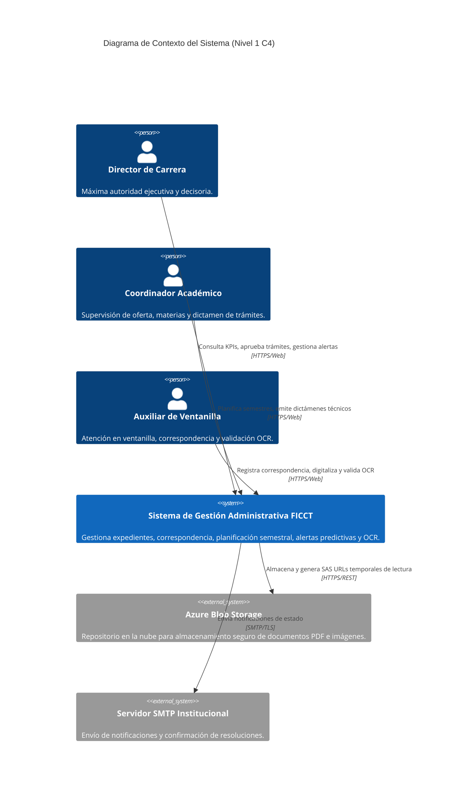
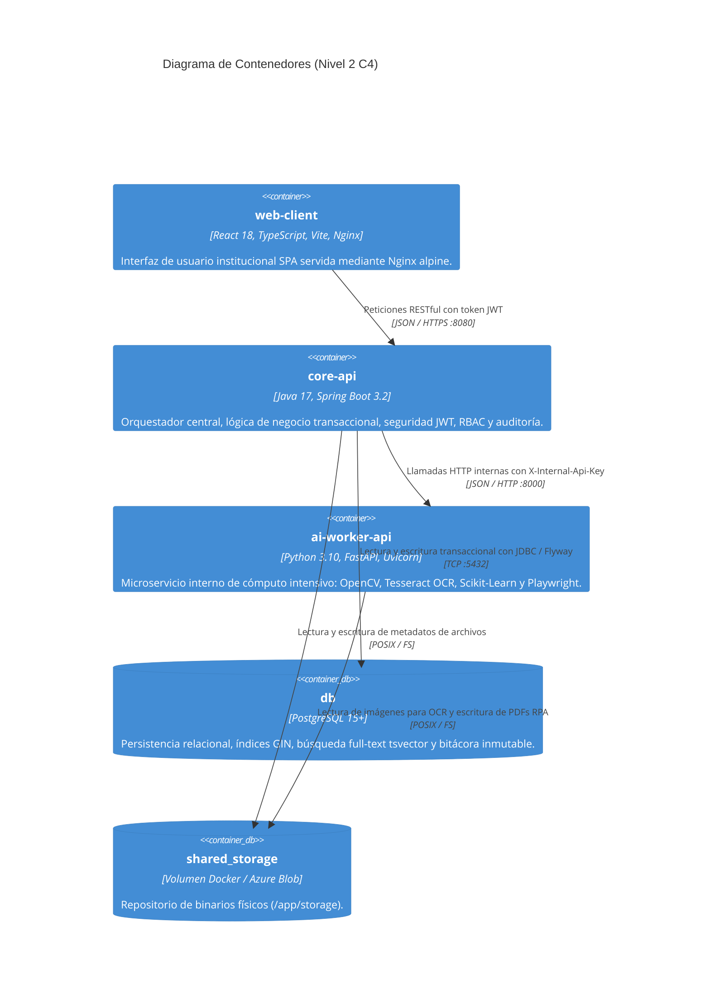

# ARCHITECTURE_OVERVIEW.md
# Visión General de la Arquitectura del Sistema (Modelo C4)

## 1. Propósito y Principios de Diseño
Este documento describe la arquitectura global del **Sistema Web de Gestión Administrativa con Alertas Predictivas y OCR para la Dirección de Carrera de Ingeniería en Sistemas (FICCT - UAGRM)** mediante el enfoque del **Modelo C4** (Contexto, Contenedores, Componentes).

---

## 2. Nivel 1: Diagrama de Contexto del Sistema

---

## 3. Nivel 2: Diagrama de Contenedores

---

## 4. Topología en Estrella y Reglas de Flujo de Datos

1. **Unicidad de la Frontera Externa:**
   * El navegador web (`web-client`) **únicamente se comunica con `core-api`**.
   * `ai-worker-api` reside en una red interna privada de Docker (`ficct_network`) y no expone ningún puerto al host público.
2. **Orquestación Transaccional:**
   * Cuando el usuario solicita un proceso de OCR, la petición llega a `core-api`. Este valida los permisos del funcionario, registra la solicitud en base de datos y llama a `ai-worker-api` mediante `WebClient`.
   * Al recibir la respuesta con el texto extraído y el nivel de confianza, `core-api` consolida los datos y responde al frontend.
3. **Manejo Eficiente de Archivos Binarios:**
   * Para evitar transferir archivos binarios pesados (PDFs de 20 MB o imágenes escaneadas) por las llamadas HTTP entre Java y Python, ambos servicios comparten el volumen físico `/app/storage` (o utilizan SAS URLs temporales de Azure Blob Storage). Solo intercambian rutas relativas o identificadores numéricos.

---

## 5. Estrategia de Resiliencia y Fallos

* **Aislamiento de Cómputo:** Si `ai-worker-api` experimenta sobrecarga de CPU durante un entrenamiento de Machine Learning, `core-api` sigue atendiendo con total normalidad las peticiones transaccionales de ventanilla.
* **Manejo de Timeouts:** Las llamadas de `core-api` a `ai-worker-api` están configuradas con un Read Timeout de 120 segundos y reintentos automáticos para mitigar latencias en documentos de gran volumen.
* **Transacciones de Auditoría Independientes:** La escritura en `bitacora_auditoria` se ejecuta con `Propagation.REQUIRES_NEW`, garantizando que incluso si una transacción de negocio falla y hace rollback, el intento o la excepción quede registrada para trazabilidad forense.
