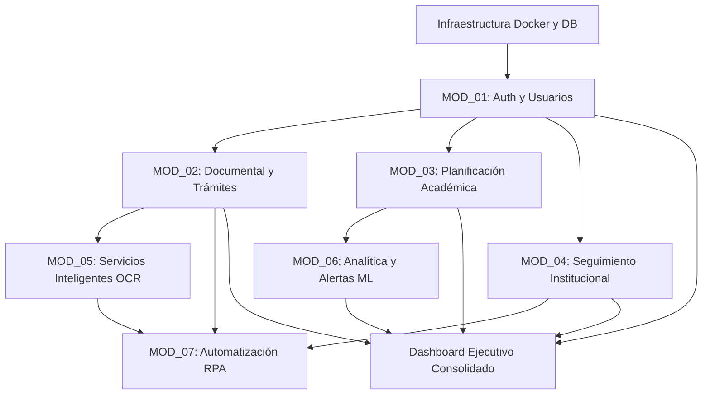

# DEPENDENCY_MATRIX.md
# Matriz de Dependencias entre Módulos, Tablas y Servicios

## 1. Propósito de la Matriz
Para evitar errores de referencias circulares, claves foráneas inexistentes o fallos de compilación durante el desarrollo por agentes de IA, este documento establece el **orden estricto de precedencia** entre componentes.

---

## 2. Grafo de Dependencias entre Módulos

---

## 3. Matriz Detallada de Precedencia Técnica

| Módulo | Tablas Requeridas Previamente | Servicios / APIs Requeridos | Módulos que Dependen de Este |
| :--- | :--- | :--- | :--- |
| **MOD_01 (Auth y Usuarios)** | Ninguna (Es la base fundacional). Crea `roles`, `usuarios`, `bitacora_auditoria`. | Spring Security, PostgreSQL | **TODOS** los módulos (todas las tablas registran `usuario_id` o actor). |
| **MOD_02 (Documental)** | `usuarios` | Almacenamiento local `/app/storage` o Azure Blob | `MOD_04`, `MOD_05`, `MOD_07`. |
| **MOD_03 (Académico)** | `usuarios` | Base relacional | `MOD_02` (para validar carrera y materias), `MOD_06` (ML). |
| **MOD_05 (OCR)** | `documentos_digitales`, `usuarios` | `ai-worker-api` (FastAPI + OpenCV + Tesseract) | `MOD_02` (Visor de trámites), Búsqueda Full-Text. |
| **MOD_06 (Analítica y ML)** | `oferta_grupos_materia`, `prerrequisitos_materia`, `usuarios` | `ai-worker-api` (Scikit-Learn Random Forest) | Dashboard directivo, módulo de alertas. |
| **MOD_04 (Institucional)** | `usuarios`, `documentos_digitales` | Base relacional | Dashboard, Reportes. |
| **MOD_07 (RPA)** | `correspondencia`, `tramites_estudiantiles`, `documentos_digitales` | `ai-worker-api` (Playwright Chromium) | Módulo documental y reportes ejecutivos. |

---

## 4. Regla de Construcción para la IA
* **PROHIBICIÓN:** El agente de IA **nunca debe intentar construir `MOD_05` (OCR) o `MOD_06` (Machine Learning)** sin haber completado y probado previamente `MOD_01` (Seguridad y Base de Datos) y `MOD_02` (Gestión Documental).
