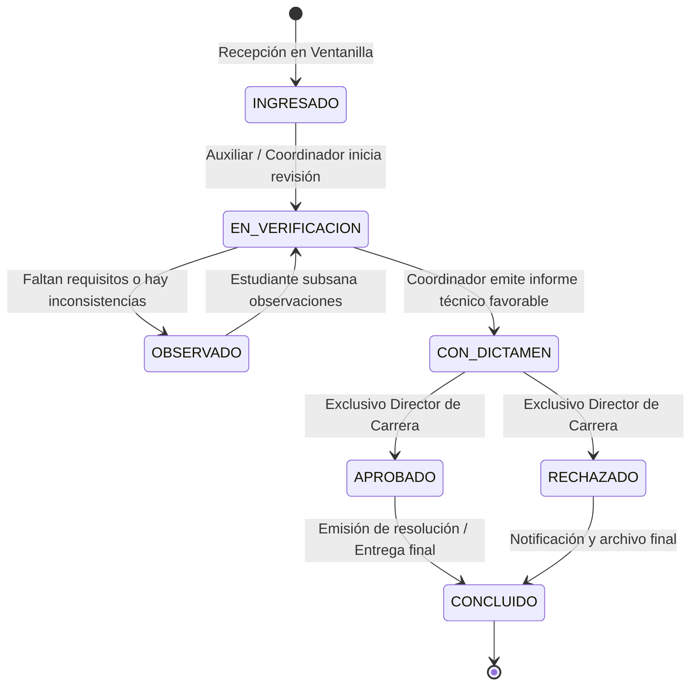

# MOD_02_DOCUMENTAL_Y_TRAMITES.md
# Especificación Funcional: Gestión Documental, Correspondencia y Trámites (State Machine)

## 1. Alcance y Casos de Uso Vinculados
Este módulo constituye el núcleo operativo de la Dirección de Carrera: administra la correspondencia oficial entrante/saliente, el repositorio de documentos digitales y el ciclo de vida estricto de los expedientes de trámites estudiantiles gobernados por una **Máquina de Estados Finitos (State Machine)**.

* **Requisitos del Proyecto:** RF-06 al RF-09.
* **Casos de Uso IEEE 830 / RUP:**
  * `CU-05`: Gestionar correspondencia institucional (Recibida y Emitida).
  * `CU-06`: Gestionar seguimiento y derivación de correspondencia.
  * `CU-07`: Gestionar documentos digitales y almacenamiento.
  * `CU-08`: Gestionar expedientes administrativos.
  * `CU-09`: Registrar trámite o solicitud estudiantil.
  * `CU-10`: Gestionar requisitos y documentación adjunta del trámite.
  * `CU-11`: Ejecutar actuaciones sobre un trámite (State Machine).
  * `CU-12`: Consultar seguimiento e historial inmutable del expediente.

---

## 2. Reglas Inmutables de Negocio (Guardarraíles)

### 2.1. Máquina de Estados Finitos de Trámites Estudiantiles
Los trámites no pueden saltarse etapas mediante actualizaciones directas en base de datos. Deben seguir obligatoriamente este grafo de transiciones:

### 2.2. Matriz Estricta de Permisos por Transición
| Transición de Estado | Roles Autorizados | Condición Previa Obligatoria |
| :--- | :--- | :--- |
| `INGRESADO` $\rightarrow$ `EN_VERIFICACION` | `AUXILIAR`, `COORDINADOR` | Expediente registrado con datos del estudiante. |
| `EN_VERIFICACION` $\rightarrow$ `OBSERVADO` | `AUXILIAR`, `COORDINADOR` | Al menos un requisito marcado como `OBSERVADO`. |
| `OBSERVADO` $\rightarrow$ `EN_VERIFICACION` | `AUXILIAR`, `COORDINADOR` | Requisito observado fue reemplazado con nuevo archivo. |
| `EN_VERIFICACION` $\rightarrow$ `CON_DICTAMEN` | **Exclusivo `COORDINADOR`** | **Todos los requisitos obligatorios deben estar en `CONFORME`.** |
| `CON_DICTAMEN` $\rightarrow$ `APROBADO` | **Exclusivo `DIRECTOR`** | Trámite cuenta con dictamen técnico previo. |
| `CON_DICTAMEN` $\rightarrow$ `RECHAZADO` | **Exclusivo `DIRECTOR`** | Justificación formal obligatoria en el dictamen final. |
| `APROBADO`/`RECHAZADO` $\rightarrow$ `CONCLUIDO` | `AUXILIAR`, `COORDINADOR`, `DIRECTOR` | Registro de entrega o notificación. |

### 2.3. Integridad de Documentos Digitales
* Cada archivo cargado calcula su hash `SHA-256` en el servidor antes de guardarse en el almacenamiento físico (`/app/storage` o Azure Blob).
* Para visualizar archivos en el navegador, el backend genera **SAS URLs de lectura temporales con expiración de 15 minutos**.

---

## 3. Especificación Técnica Backend (`core-api`)

### 3.1. Paquete y Clases Principales
* **Paquete:** `bo.edu.uagrm.ficct.sistemas.gestion.modules.documental`
* **Controladores:**
  * `CorrespondenciaController` (`/api/v1/correspondencia`): Gestión y derivaciones.
  * `DocumentoDigitalController` (`/api/v1/documentos`): Upload `multipart/form-data` y generación de SAS URLs.
  * `TramiteEstudiantilController` (`/api/v1/tramites`): Creación de expedientes, revisión de requisitos y endpoint crítico de transiciones `/api/v1/tramites/{id}/transicion`.
* **Entidades Clave:**
  * `Correspondencia`, `SeguimientoCorrespondencia`, `DocumentoDigital`, `TramiteEstudiantil`, `RequisitoPresentadoTramite`, `HistorialEstadosTramite`.

---

## 4. Especificación Técnica Frontend (`web-client`)

### 4.1. Módulos `features/documental/` y `features/tramites/`
* **Componente `TramiteTimeline.tsx`:**
  * Renderiza visualmente la barra de avance (Stepper) con iconos y colores representativos de cada estado.
  * Muestra el histórico de transiciones pasadas con el funcionario que actuó, la fecha exacta y el dictamen emitido.
* **Componente `TransicionModal.tsx`:**
  * Detecta el estado actual del expediente y el rol del usuario autenticado para mostrar **únicamente los estados de destino válidos**.
  * Si el usuario es Auxiliar y el estado es `CON_DICTAMEN`, no le muestra botones de resolución (pues son exclusivos del Director).
* **Componente `RequisitosChecklist.tsx`:**
  * Lista interactiva de requisitos: permite al Auxiliar/Coordinador previsualizar el PDF adjunto y marcar cada ítem con un clic como `CONFORME` o ingresar motivo de `OBSERVADO`.

---

## 5. Pruebas y Criterios de Aceptación
1. Intentar pasar de `INGRESADO` a `CON_DICTAMEN` debe devolver `HTTP 409 Conflict` indicando transición ilegal.
2. Un `ROLE_COORDINADOR` que intente aprobar directamente un trámite debe recibir `HTTP 403 Forbidden`.
3. Intentar pasar a `CON_DICTAMEN` cuando existe al menos un requisito en `PENDIENTE` u `OBSERVADO` debe ser rechazado.
4. Toda transición exitosa debe insertar un registro inalterable en `historial_estados_tramite`.
